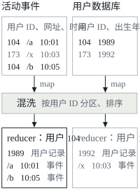
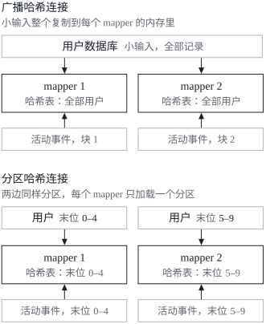
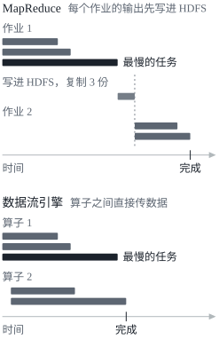

这是 DDIA 读书笔记的第十篇。[第九篇](/posts/ddia-09/)讲完一致性与共识，全书的第二部分“分布式数据”就结束了，第十章是第三部分“派生数据”的第一章。这一篇按我理解的几条主线整理，不按书的小节顺序。文中的英文引文出自原书，其余是我自己的整理。

第三部分先换了一个视角。前两部分默认应用只有一个数据库，可真实的应用往往同时用着好几个系统：数据库、缓存、全文索引、分析用的数据仓库。书把存储和处理数据的系统分成两类：**记录系统**（system of record，也叫 source of truth）保存数据的权威版本，新数据先写到这里，每个事实只记一次；**派生数据**（derived data）是从别的系统取来数据、经过转换或处理得到的结果，比如缓存、索引和物化视图，丢了也能从源头重新算出来。派生数据是冗余的，却往往是读得快的前提。一个数据库算哪一类，不取决于数据库本身，而取决于应用怎么用它。第三部分的三章都在讲怎样产生和维护派生数据：这一章是批处理，第 11 章是流处理，第 12 章讨论怎样用这些工具搭出可靠、可扩展、可维护的应用。

这一章开头引了 Donald Knuth 谈 TeX 的一段话：

> A system cannot be successful if it is too strongly influenced by a single person. Once the initial design is complete and fairly robust, the real test begins as people with many different viewpoints undertake their own experiments.

一个系统要经得起很多不同的人拿去做各自的实验，才算成功。这一章从 Unix 工具讲到 MapReduce，再讲到 Spark 和 Flink，讲的正是这样一类系统：输入不变，输出随时可以重新算，谁都可以放心地拿数据去试。

书先区分了三种系统：

| 类型 | 怎样运行 | 主要看什么 |
| --- | --- | --- |
| 服务（在线系统） | 等着客户端的请求，尽快回应 | 响应时间、可用性 |
| 批处理（离线系统） | 拿一大批输入跑一个作业，通常定期运行，一次几分钟到几天，没有人在等 | 吞吐量 |
| 流处理（近实时系统） | 事件发生后不久就处理它，介于两者之间 | 延迟 |

批处理其实非常古老，1890 年美国人口普查用的穿孔卡片制表机，就是一种半机械化的批处理。MapReduce 是 Google 2004 年发表的，后来被 Hadoop 等系统实现。书里说它的重要性已经在下降，可它把批处理为什么有用讲得很清楚，值得仔细看。

## Unix 管道：批处理的雏形

书从一个简单的例子讲起：在 Web 服务器的访问日志里，找出访问量最高的 5 个页面。用 Unix 工具，一行就能写完：

```bash
cat /var/log/nginx/access.log |
  awk '{print $7}' |
  sort             |
  uniq -c          |
  sort -r -n       |
  head -n 5
```

`awk` 取出每行的第 7 个字段，也就是请求的网址；`sort` 把相同的网址排到一起；`uniq -c` 数出每个网址连续出现了几次；最后按次数倒序排，取前 5 个。这样一条看似晦涩的命令，几秒钟就能处理几个 GB 的日志，想改成统计客户端 IP，也只要改个参数。

同样的事也可以写一个小程序，用内存里的一张哈希表给每个网址计数。两种做法的区别在**工作集**（working set），也就是需要随机访问的内存有多大。哈希表要装下所有不同的网址，网址太多就放不下；排序却可以把数据分批排好写到磁盘上，再把几个有序的文件合并起来，和[第三篇](/posts/ddia-03/)的 SSTable、LSM 树是同一个思路，磁盘上全是顺序读写。GNU 的 `sort` 会自动把放不下的数据溢写到磁盘，还会用上多个 CPU 核。所以排序的做法能处理比内存大得多的数据，瓶颈多半只是读磁盘的速度。

这条管道之所以拼得起来，靠的是 Unix 哲学。书里引了 1978 年 Doug McIlroy 等人对它的总结，其中一条是：

> Expect the output of every program to become the input to another, as yet unknown, program.

每个程序的输出，都应该能成为另一个程序的输入，哪怕那个程序现在还不存在。其余几条是：一个程序只做好一件事；尽早让软件试用起来，笨拙的部分毫不犹豫地扔掉重写；宁可先造工具，也要减轻编程的负担。这和今天说的敏捷、DevOps 很像，四十年来变化不大。落到设计上，是三个特点：

- **统一接口**（uniform interface）：所有程序都读写文件，也就是一串有序的字节，并且按惯例把它当成以换行分隔的文本记录。磁盘文件、管道、设备、TCP 连接都长成这个样子，所以任意两个程序都能接到一起。代价是解析含糊，`{print $7}` 远不如 `{print $request_url}` 好读；
- **逻辑与布线分离**（separation of logic and wiring）：程序只管从标准输入读、往标准输出写，不关心数据从哪里来、到哪里去，怎么连由 shell 的使用者决定。程序需要多个输入或输出时，这种方式就很别扭；
- **透明，适合做实验**：输入文件不会被修改，可以反复运行、试各种参数；在管道的任何一处接上 `less` 就能看中间结果；把某一步的输出存成文件，下一步就能单独重跑。

Unix 工具最大的局限是只能在一台机器上跑，于是有了 Hadoop。

## MapReduce：分布在几千台机器上的管道

一个 MapReduce 作业和一个 Unix 进程很像：读一个或多个输入，产生一个或多个输出，不修改输入，除了输出没有别的副作用。不同的是，它读写的不是本地文件，而是**分布式文件系统**（distributed filesystem）上的文件。

Hadoop 用的是 HDFS，它是 Google GFS 的开源实现，也是[第五篇](/posts/ddia-05/)讲过的**无共享架构**：每台机器运行一个守护进程，对外提供本机磁盘上的文件；一个叫 NameNode 的中心服务器记录每个文件块存在哪些机器上。文件块在多台机器上复制，或者用 Reed–Solomon 这样的**纠删码**（erasure coding）保存，比整份复制更省空间。书写作时，最大的 HDFS 部署跑在几万台机器上，总容量有几百 PB。

### 一个作业怎样运行

回到日志的例子，一个 MapReduce 作业分四步：

1. 读入输入文件，切成记录，这里一行就是一条；
2. 对每条记录调用 **mapper**，取出一个键和一个值，这里键是网址，值为空，相当于 `awk '{print $7}'`；
3. 按键给所有键值对排序，相当于第一个 `sort`；
4. 对排好序的键值对调用 **reducer**，相同的键挨在一起，一次处理一个键的所有值，相当于 `uniq -c`。

第 2、4 步是用户写的代码，第 3 步的排序是隐含的。mapper 一次处理一条记录，可以输出任意多个键值对，不在记录之间保留状态；框架把同一个键的所有值收集起来，用一个迭代器交给 reducer。mapper 负责把数据整理成适合排序的形式，reducer 负责处理排好序的数据。还想按访问次数排一次序，就得再写一个作业。

和 Unix 管道相比，最大的不同是 MapReduce 能在很多台机器上并行，而用户不用写任何并行的代码。并行的基础是[第六篇](/posts/ddia-06/)讲的分区：每个输入文件块由一个 map 任务处理，调度器尽量把任务放到存有这块数据的机器上，省掉网络传输；框架按键的哈希决定每个键值对去哪个 reduce 任务。map 任务把输出按 reduce 分区写成本地磁盘上排好序的文件，reduce 任务再取回属于自己的那一份，归并起来。这个按 reducer 分区、排序、从 mapper 拷贝到 reducer 的过程叫**混洗**（shuffle），虽然名字像洗牌，它没有任何随机性。

### 工作流

一个作业能做的事有限，所以作业常常串成**工作流**（workflow）：前一个作业的输出目录，就是后一个作业的输入目录。Hadoop 本身并不知道两个作业之间的关系，而作业的输出只有在作业成功完成之后才算数，所以需要 Oozie、Azkaban、Luigi、Airflow 这样的**工作流调度器**来安排先后。构建推荐系统时，一个工作流有 50 到 100 个 MapReduce 作业很常见。Pig、Hive、Cascading 这些高层工具，会把多个阶段自动连成工作流。

这样串起来的作业不像 Unix 管道那样在进程之间用一小块内存缓冲直接传数据，更像每条命令都把输出写进一个临时文件，下一条命令再去读。这个差别后面还会讲到。

## 把相关的数据带到一起：连接与分组

数据库里查少量记录要靠索引，可 MapReduce 没有索引的概念，读输入就是全表扫描。只查一条记录时这很浪费，但批处理本来就是要对大量记录做聚合，在很多机器上并行地全扫描是合理的。所以批处理里说的连接，是一次把一个关联的所有出现都解析出来，同时处理所有用户，而不是查某一个用户。

书里的例子是[第三篇](/posts/ddia-03/)讲过的**星型模式**：用户的活动事件是事实表，用户数据库是一张维度表。想知道各个年龄段的人最常看哪些页面，就要把两者连接起来。逐条处理事件、每条都去远程数据库查一次用户，吞吐量受限于网络往返，还可能压垮数据库，而且远程的数据随时会变，作业的结果就不确定了。更好的做法是把用户数据库的一份副本（比如用 ETL 从备份里抽出来）也放进分布式文件系统，再用 MapReduce 把相关的记录带到同一个地方。

### reduce 端的排序合并连接

两组 mapper 分别读两个输入：读活动事件的输出（用户 ID，事件），读用户数据库的输出（用户 ID，出生日期）。按用户 ID 分区、排序以后，同一个用户的所有记录就挨在了一起，交给同一次 reducer 调用。还可以让排序把用户记录排在最前面，后面是按时间排好的事件，这叫**二次排序**（secondary sort）。



reducer 先读到出生日期，存进一个局部变量，再遍历这个用户的事件，输出（网址，访问者年龄）。它一次只需要在内存里放一条用户记录，也从不发网络请求。这就是**排序合并连接**（sort-merge join）：mapper 的输出按键排好序，reducer 把连接两边的有序列表合并起来。

换个角度看，mapper 是在给 reducer “发消息”，键就是收件地址，同一个键的消息都投递到同一个地方。MapReduce 把物理上的网络通信（把数据送到对的机器）和应用逻辑（数据到了以后怎么处理）分开了。通信全由框架处理，节点崩溃时它也能悄悄重试失败的任务，应用代码完全不用操心。

### 分组和偏斜

把相关的数据带到一起，另一个用途是**分组**（grouping），相当于 SQL 的 `GROUP BY`：以分组键作为 mapper 输出的键，分区和排序就会把同一组的记录送到同一个 reducer，再计数、求和或者取前几名。所以在 MapReduce 上，分组和连接看起来几乎一样。一个常见的例子是**会话化**（sessionization）：一个用户的点击散落在很多台 Web 服务器的日志里，以会话 cookie 或用户 ID 分组，就能还原出这个用户的操作序列，用来分析 A/B 测试的效果。

这种模式在单个键的数据特别多时就不灵了。社交网络里大多数用户只有几百个好友，名人却有几百万个关注者，这样的键叫**热键**（hot key）。把一个名人的所有活动送进同一个 reducer，就会造成**偏斜**：这个 reducer 的工作量远超其他，而整个作业要等最慢的 reducer 做完。应对的办法和[第六篇](/posts/ddia-06/)缓解热点的思路一样，靠随机化把热键摊开：Pig 的偏斜连接先跑一个采样作业找出热键，连接时把热键的记录随机发给几个 reducer 之一，另一边与热键相关的记录则复制给所有这些 reducer；按热键分组聚合时，可以先把记录随机分给多个 reducer 各自聚合，第二个作业再把中间值合成每个键一个值。

### map 端连接

上面的连接都在 reducer 里完成，叫 **reduce 端连接**（reduce-side join）。它的好处是对输入不做任何假设，坏处是排序、拷贝到 reducer、归并都很贵，数据可能要写好几次磁盘。如果能对输入做一些假设，就可以在 map 端完成连接：没有 reducer，也不用排序，每个 mapper 读一块输入，写一个输出文件。



| 连接方式 | 前提 | 怎样做 |
| --- | --- | --- |
| reduce 端排序合并连接 | 无 | mapper 按连接键分区、排序，reducer 合并两边的有序列表 |
| 广播哈希连接 | 一个输入小到能放进内存 | 每个 mapper 把整个小输入读进哈希表，再扫描自己那块大输入 |
| 分区哈希连接 | 两个输入按同样的键、同样的方式分成同样多的区 | 每个 mapper 只把对应分区的小输入读进哈希表 |
| map 端合并连接 | 两个输入同样分区，而且都按键排好序 | mapper 像 reducer 那样顺序合并两个输入 |

表里的**广播哈希连接**（broadcast hash join）在 Hive 里叫 MapJoin；**分区哈希连接**（partitioned hash join）在 Hive 里叫 bucketed map join，如果输入是之前做过同样分组的作业生成的，它的前提很容易满足。选哪种连接还会影响输出的结构：reduce 端连接的输出按连接键分区、排序，map 端连接的输出沿用大输入的分区和顺序。所以优化连接时，还要知道数据集分了几个区、按什么键分区和排序，Hadoop 生态里这些元数据放在 HCatalog 和 Hive metastore 里。

## 输出：不可变的数据集

批处理既不是事务处理，也不完全是分析。它像分析一样扫描大量输入，可它的输出往往不是报表，而是另一种数据结构。

### 搜索索引和键值文件

Google 最初用 MapReduce，就是为搜索引擎建索引，那是一个由 5 到 10 个作业组成的工作流。全文索引的核心是一个词典，按关键词查到包含它的所有文档 ID。对一批固定的文档，用批处理建索引很合适：mapper 按需要给文档分区，每个 reducer 为自己的分区建索引，写回分布式文件系统。索引建好以后只读不改，文档有变化时，可以定期把整个工作流重跑一遍，整体替换旧的索引；也可以像[第三篇](/posts/ddia-03/)讲的 Lucene 那样，增量地写新的段，再在后台合并。全量重建的计算量大，却非常好推理：文档进去，索引出来。

另一类常见的输出，是推荐系统这类机器学习应用要查的数据库，比如按用户 ID 查可能认识的人。最直接的想法是在 mapper 或 reducer 里调用数据库客户端，一条一条写进去，书里说这是个坏主意：每条记录一次网络请求，比批处理正常的吞吐量慢好几个数量级；大量任务同时写，很容易把数据库压垮；而且 MapReduce 本来保证全有或全无，作业失败就没有输出，从作业里写外部系统，部分完成的结果就会被别人看到，任务重试和推测执行还会带来重复写入。

更好的做法是在作业里直接生成一个全新的数据库：像建索引那样把数据文件写进输出目录，再整批加载到提供只读查询的服务器上，Voldemort、Terrapin、ElephantDB 和 HBase 的**批量加载**（bulk loading）都支持这种方式[^voldemort]。按键排序本来就是建索引的大部分工作，文件只读不改，也不需要预写日志。Voldemort 加载新数据时，继续用旧文件回应请求，新文件拷到本地以后再原子地切换过去，出了问题随时可以切回去。

### 为什么输出要不可变

这和 Unix 的哲学一脉相承：输入不可变，没有副作用，新的输出整体替换旧的输出。好处不只是性能：

- **容忍人的错误**：代码有 bug、输出错了，回滚代码重跑一遍，或者切回旧的输出目录就行；读写型的数据库没有这个性质，写坏的数据不会因为回滚代码就复原；
- **开发更快**：错误容易撤销，就敢更快地试新功能，书里把这叫作**最小化不可逆性**（minimizing irreversibility）；
- **重试是安全的**：任务失败了，框架在别处重跑，失败任务的输出直接丢弃，因为输入从来没有被改过；
- **一份数据多种用途**：同一批文件可以给好几个作业用，包括和上一次运行结果做比较的监控作业。

和 Unix 不同的是，Hadoop 上通常不用无类型的文本，而用 Avro、Parquet 这样带模式的格式（见[第四篇](/posts/ddia-04/)），省掉低价值的解析。

## Hadoop 与 MPP 数据库

Hadoop 有点像分布式版的 Unix：HDFS 是文件系统，MapReduce 是一种古怪的 Unix 进程，在 map 和 reduce 之间总要跑一遍 `sort`。MapReduce 论文发表时，它在某种意义上一点也不新：前面讲的并行连接和处理算法，十多年前就已经在**大规模并行处理**（massively parallel processing，MPP）数据库里实现过了，比如 Gamma、Teradata 和 Tandem NonStop SQL。区别在于，MPP 数据库专门在集群上并行执行分析型的 SQL，而 MapReduce 加上分布式文件系统提供的是一个更像通用操作系统的东西，可以运行任意程序。

| | MPP 数据库 | Hadoop（MapReduce） |
| --- | --- | --- |
| 存储 | 导入之前要仔细建模，存成专有格式 | 文件只是字节序列，任何格式都能先存进来 |
| 处理 | SQL，单体、紧耦合的软件，优化得很好 | 任意代码，多种处理模型共用一个集群 |
| 故障 | 一个节点崩溃就中止整个查询 | 只重跑失败的任务 |
| 内存与磁盘 | 尽量把数据留在内存里 | 积极地写磁盘 |

### 先存下来，以后再想

Hadoop 让人可以先把数据一股脑存进 HDFS，以后再考虑怎么处理。较真的人会觉得先仔细建模更好，可实践中，尽快让数据可用，哪怕格式古怪难用，往往比先定下理想的数据模型更有价值。这种做法叫**数据湖**（data lake）或企业数据中枢：把各处的数据以原始的形式收集到一起，解释数据的负担从生产者转到了消费者身上，也就是[第二篇](/posts/ddia-02/)讲的**读时模式**。同一份原始数据，不同的团队可以转换成各自需要的样子，这被称为**寿司原则**（sushi principle）：原始数据更好。Hadoop 常被用来做 ETL：把事务系统的原始数据倒进分布式文件系统，用 MapReduce 清洗、转换成关系的形式，再导入 MPP 数据仓库做分析。建模仍然要做，只是和数据收集解耦了。

处理也一样。推荐系统、带相关性排序的全文索引、图像分析都没法只用 SQL 写，需要写代码。Hive 在 MapReduce 上实现了 SQL，同一个集群上还能跑 HBase 这样的随机访问数据库、Impala 这样 MPP 风格的分析引擎，它们共用 HDFS 上的同一批文件，不必把数据搬来搬去。

### 为频繁的任务终止而设计

MapReduce 为什么只在任务级别重试，又那么积极地写磁盘？机器确实会坏，可没有频繁到让大部分作业都遇上的程度，为容错付出这么大的开销值得吗？

要看它最初的运行环境。Google 的数据中心是混用的：在线的生产服务和离线的批处理跑在同样的机器上，每个任务有资源配额和优先级，高优先级的任务需要资源时，可以终止（抢占）同一台机器上低优先级的任务。这样就能放心地超卖低优先级的计算资源，机器的利用率比把生产和非生产任务分开要高。MapReduce 作业以低优先级运行，用的是高优先级进程挑剩下的资源，随时可能被抢占。在 Google，一个运行一小时的 MapReduce 任务大约有 5% 的概率被终止，比硬件故障、机器重启等原因造成的失败率高出一个数量级以上。照这个比率，一个作业有 100 个任务、每个跑 10 分钟，至少有一个任务中途被终止的概率超过 50%。

所以 MapReduce 能容忍频繁、意外的任务终止，不是因为硬件特别不可靠，而是因为能随意终止进程，整个集群的资源才用得更充分。书写作时，开源的调度器很少这样做：YARN 的 CapacityScheduler 能为平衡各个队列的资源而抢占，可 YARN、Mesos 和 Kubernetes 都不支持通用的优先级抢占[^k8s]。在任务不常被终止的环境里，MapReduce 的这些设计就没那么合理了。

## MapReduce 之后

书花这么多篇幅讲 MapReduce，是因为它很容易理解，是很好的学习工具；可它并不好用，用原生的 API 写任何一种连接都得从头实现。Pig、Hive 这些高层工具解决了易用的问题，MapReduce 执行模型本身的问题，却不是多加一层抽象就能解决的。

### 物化中间状态的代价

如果一个作业的输出要发布给组织里的其他团队用，把它写成分布式文件系统上的文件很合理。可很多时候，一个作业的输出只给同一个团队的下一个作业用，它只是**中间状态**。把中间状态写进文件，叫作**物化**（materialization），和[第三篇](/posts/ddia-03/)的物化视图是同一个词：提前把结果算好写出来，而不是需要时再算。Unix 管道则不物化中间状态，只用一小块内存缓冲，把输出一点点流给下一个程序。

MapReduce 把中间状态完全物化，有三个坏处：

- 下一个作业要等上一个作业的所有任务都完成才能开始，而偏斜或者机器负载不均，常常让个别任务比其他任务慢得多，拖慢整个工作流；
- mapper 常常是多余的：它只是把上一个 reducer 刚写出的文件读回来，为下一次分区和排序做准备，这些代码本可以并进上一个 reducer；
- 中间状态存在分布式文件系统里，就要在好几个节点上复制，对临时数据来说太过了。



### 数据流引擎

Spark、Tez 和 Flink 这样的**数据流引擎**（dataflow engine）就是为解决这些问题出现的。它们把整个工作流当成一个作业，同样对每条记录反复调用用户定义的函数、靠分区并行，只是这些函数叫**算子**（operator），不必严格地交替扮演 map 和 reduce。算子之间可以按键重新分区并排序（和混洗一样），也可以只分区不排序，或者把一份输出广播给所有分区。好处是：排序只在真正需要的地方做；没有多余的 map 任务；调度器看得到整个工作流，可以把消费数据的任务放到产生数据的机器上；中间状态放在内存或本地磁盘，不写进 HDFS，也就不用复制；算子的输入一就绪就能开始，不用等前一个阶段全部完成。用 Pig、Hive 写的工作流，改一下配置就能从 MapReduce 换到 Tez 或 Spark 上跑。

不写 HDFS，容错就要换个办法：一台机器挂了，它上面的中间状态丢了，就用还在的数据重新算出来。为此框架要记住每块数据是怎么算出来的，Spark 用 RDD 记录这种**血缘**（lineage），Flink 则给算子的状态做检查点。重算时，算子是不是**确定性的**（deterministic）就很重要：如果丢失的数据有一部分已经发给了下游，重算出来的又和原来的不一样，下游就没法调和新旧数据，只能连下游一起重跑。遍历顺序不固定的哈希表、随机数、系统时钟都会悄悄带进非确定性，比如随机数就要用固定的种子生成。重算也不总是更划算：中间数据很小，或者计算非常耗 CPU 时，物化下来反而更便宜。

回到 Unix 的比喻：MapReduce 像把每条命令的输出写进临时文件，数据流引擎更像 Unix 管道，Flink 尤其是围绕流水线执行设计的。当然，排序要读完全部输入才能产出第一条输出，需要排序的算子总要暂时攒下状态。作业的输入和最终输出仍然在 HDFS 上，输入不变、输出整体替换的原则也没有变。

### 图和迭代处理

[第二篇](/posts/ddia-02/)讲的图模型是 OLTP 式的用法，批处理关心的则是对整个图做离线分析，比如 PageRank 这样根据链接给网页排名的算法。这类算法要沿着边一步步传播信息，重复到满足某个条件为止，而 MapReduce 每一轮都要读完整个输入、写出全新的输出，哪怕图只变了一小部分。

于是出现了**批量同步并行**（bulk synchronous parallel，BSP）模型，因 Google 的 Pregel 论文而流行，Apache Giraph、Spark 的 GraphX 和 Flink 的 Gelly 都实现了它。思路和 mapper 给 reducer 发消息类似：顶点沿着边给别的顶点发消息，每一轮对每个顶点调用一次函数，交给它收到的消息；不同的是，顶点在内存里记住自己跨轮次的状态，没收到消息的部分就不用做任何事。容错靠每轮结束时给所有顶点的状态做检查点。图通常只按顶点 ID 随意分区，跨机器的消息很多，所以书里提醒，图能放进一台机器的内存时，单机甚至单线程的算法很可能比分布式的批处理还快。

### 高层 API：越来越像数据库

手写 MapReduce 作业太费力，所以 Hive、Pig 这些高层语言流行了起来，Spark 和 Flink 也有自己的数据流 API。它们多用关系式的积木表达计算：连接、分组、过滤、聚合，内部用的就是这一章讲的算法。用关系算子声明连接，框架就能分析输入的特点，自动选择连接算法，Hive、Spark 和 Flink 都有基于代价的查询优化器，甚至能调整连接的顺序，这就是[第二篇](/posts/ddia-02/)讲的声明式查询。同时它们仍然可以调用任意代码，用上各种语言现成的库，这一直是这类系统和 MPP 数据库的区别。

简单的过滤和选字段如果也用声明式的方式写，查询优化器就能利用列式存储只读需要的列，还能用上[第三篇](/posts/ddia-03/)讲的**向量化处理**：Spark 生成 JVM 字节码，Impala 用 LLVM 生成本机代码，在对 CPU 缓存友好的紧凑循环里处理数据。批处理框架因此越来越像 MPP 数据库，性能也能相比，又保留了运行任意代码、读写任意格式的灵活性；MPP 数据库反过来也变得更可编程。说到底，两边都只是存储和处理数据的系统。

## 小结

我从这一章带走的几点：

- 批处理的核心是输入不变、没有副作用。mapper 和 reducer 被限制成无状态的回调函数，框架才能放心地重试、丢掉失败任务的输出，把分区和容错这两个最难的问题藏在抽象后面；
- 连接和分组，本质上都是把相关的数据带到同一个地方。不做任何假设时用 reduce 端的排序合并连接，一边很小或者两边已经同样分区时用 map 端连接；
- 批处理的产出是派生的数据集，比如索引和只读的键值文件，整体替换、可以回滚；
- MapReduce 积极写磁盘、只重试单个任务，是为随时会抢占低优先级任务的环境设计的；
- 数据流引擎不再物化所有的中间状态，代价是重算时要求算子是确定性的；有了声明式的 API，批处理框架和 MPP 数据库越来越像。

书里的总结是：

> The distinguishing feature of a batch processing job is that it reads some input data and produces some output data, without modifying the input—in other words, the output is derived from the input.

批处理作业读输入、写输出，从不修改输入，输出是从输入派生出来的，这正好接上第三部分的主题。它的输入是**有界的**（bounded）：大小已知且固定，比如某一时刻的一组日志文件，或者数据库的一个快照，所以作业知道什么时候读完了输入，最终总会结束。第 11 章讲流处理，输入是**无界的**（unbounded），永远不会结束，这个前提一变，系统设计的很多方面都要跟着变。

## 术语表

| 英文 | 中文 | 含义 |
| --- | --- | --- |
| system of record | 记录系统 | 保存数据权威版本的系统 |
| derived data | 派生数据 | 从其他系统的数据转换、处理得到，丢了可以重新算出来 |
| working set | 工作集 | 需要随机访问的内存 |
| uniform interface | 统一接口 | Unix 里是文件，也就是一串有序的字节 |
| separation of logic and wiring | 逻辑与布线分离 | 程序只管读写，怎么连由外部决定 |
| distributed filesystem | 分布式文件系统 | 用很多台机器的磁盘组成一个文件系统，比如 HDFS |
| mapper / reducer | mapper / reducer | 从记录里取出键值对的函数 / 处理一个键所有值的函数 |
| shuffle | 混洗 | 按 reducer 分区、排序、从 mapper 拷贝到 reducer |
| secondary sort | 二次排序 | 让同一个键的值也按某种顺序到达 |
| sort-merge join | 排序合并连接 | 两个输入按连接键排好序后合并 |
| hot key | 热键 | 数据特别多、会造成偏斜的键 |
| broadcast hash join | 广播哈希连接 | 小输入整个放进每个 mapper 的哈希表 |
| partitioned hash join | 分区哈希连接 | 两个输入同样分区，每个分区各自做哈希连接 |
| bulk loading | 批量加载 | 把批处理生成的数据文件整体加载进数据库 |
| data lake | 数据湖 | 以原始形式集中存放的数据 |
| materialization | 物化 | 提前算出中间结果并写下来 |
| dataflow engine / operator | 数据流引擎 / 算子 | 把整个工作流当一个作业执行的引擎 / 其中的处理函数 |
| lineage | 血缘 | 一块数据是用哪些输入、经过哪些算子算出来的 |
| bulk synchronous parallel (BSP) | 批量同步并行 | 按轮次在顶点之间传消息的图计算模型 |
| bounded / unbounded | 有界 / 无界 | 输入大小固定 / 永远不会结束 |

[^voldemort]: 书写于 2017 年。LinkedIn 后来用自己的 Venice 取代了 Voldemort 的只读存储：到 2018 年，大约 500 个这样的用例已经全部迁移过去，批处理作业照样整批推送数据。Venice 在 2022 年开源。

[^k8s]: 书写于 2017 年。Kubernetes 后来加入了 Pod 的优先级和抢占：2017 年的 1.8 版是 alpha，2018 年的 1.11 版默认开启（beta），2019 年 3 月的 1.14 版正式可用（GA）。
