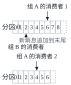
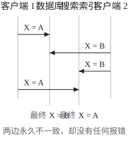

这是 DDIA 读书笔记的第十一篇。[第十篇](/posts/ddia-10/)的批处理有一个前提：输入是有界的，作业知道什么时候读完。可很多数据是源源不断产生的，今天有，明天还会有，数据集永远不会完整。每天处理一天的数据，结果就要等到第二天；切得更细，或者干脆每来一个事件就处理一个，就是流处理。这一章仍属于第三部分“派生数据”。这一篇按我理解的几条主线整理，不按书的小节顺序。文中的英文引文出自原书，其余是我自己的整理。

这一章开头引了 John Gall 1975 年的书 *Systemantics*：

> A complex system that works is invariably found to have evolved from a simple system that works. The inverse proposition also appears to be true: A complex system designed from scratch never works and cannot be made to work.

能工作的复杂系统，总是从能工作的简单系统演化来的；从零设计的复杂系统，从来跑不起来。放在流处理这一章前面，大概是在说：流处理不是凭空发明的，它是从批处理、日志和复制这些已经能用的东西里长出来的。

## 消息系统：从生产者到消费者

流处理里，一条记录通常叫一个**事件**（event）：一个小的、自包含的、不可变的对象，记录某个时刻发生了什么，通常带一个时间戳。用户看了一个页面、传感器报了一次温度，都是事件。事件由**生产者**（producer）产生一次，可以被多个**消费者**（consumer）处理，相关的事件归在一个**主题**（topic）里。

生产者可以把事件写进数据库，消费者定期去查有没有新的，可要求的延迟越低，轮询就越频繁，大部分查询都扑了空。更好的办法是有新事件时通知消费者，这正是消息系统要做的。消息系统五花八门，书里说用两个问题来区分它们最有用：

- 生产者发得比消费者处理得快，怎么办？可以丢掉消息，可以先缓存在队列里（队列装不下内存时怎么办？），也可以施加**背压**（backpressure），让生产者停下来等，Unix 管道和 TCP 就是这样；
- 节点崩溃或者暂时下线，消息会不会丢？持久化要写磁盘、做复制，都有代价。能容忍偶尔丢消息，同样的硬件就能换来更高的吞吐和更低的延迟。周期性的传感器读数丢一个无妨，计数用的事件却一条都不能丢。

有的系统让生产者直接把消息发给消费者，比如金融行业用 UDP 多播推送行情，webhook 直接调用消费者的 HTTP 接口，但它们都默认双方一直在线。更常见的是**消息代理**（message broker）：一个专门为消息流优化的数据库，生产者和消费者都是它的客户端，持久化的问题交给了代理。和数据库相比，传统的消息代理（JMS、AMQP 这类标准，RabbitMQ 这类实现）投递成功就删除消息，默认队列很短，不支持任意查询，但数据有变化时会通知客户端。

多个消费者读同一个主题时，有两种模式：**负载均衡**，每条消息只交给其中一个消费者，大家分担工作；**扇出**（fan-out），每条消息交给所有消费者，各自独立处理。为了不丢消息，消费者处理完要**确认**（acknowledgment），代理迟迟收不到确认，就把消息重新投递给另一个消费者。负载均衡加上重新投递，会打乱消息的顺序：消费者 2 处理 m3 时崩溃，m3 被重投给正在处理 m4 的消费者 1，它的处理顺序就成了 m4、m3、m5。消息之间有因果关系时，这就成了问题。

## 分区日志：把消息存成日志

发一个网络包、调一次服务，通常不留下永久的痕迹；传统消息代理即使把消息写进磁盘，投递之后也很快删掉。数据库和文件系统正相反，写进去的东西默认一直保留。这个差别很要紧：批处理能放心地反复运行、试验，靠的就是输入不会被破坏，可在 AMQP/JMS 式的系统里，收消息是破坏性的，确认就意味着删除，同一个消费者跑两遍得不到同样的结果；新加的消费者也只能收到它注册之后的消息。能不能既像数据库一样持久，又像消息系统一样低延迟地通知？这就是**基于日志的消息代理**（log-based message broker）。

日志就是磁盘上只追加的记录序列，[第三篇](/posts/ddia-03/)的存储引擎和[第五篇](/posts/ddia-05/)的复制都用过它。生产者把消息追加到日志末尾，消费者顺序读日志，读到末尾就等着新消息到来，和 `tail -f` 差不多。为了扩展，日志按[第六篇](/posts/ddia-06/)的方法分区，放在不同的机器上，一个主题就是一组分区。每个分区里，代理给每条消息分配一个单调递增的**偏移量**（offset），所以分区内的消息是全序的，跨分区则没有顺序保证。Apache Kafka、Amazon Kinesis Streams 和 Twitter 的 DistributedLog 都是这样工作的，虽然所有消息都写磁盘，靠分区和复制仍然能做到每秒几百万条消息的吞吐。

读消息不会删除它，所以扇出是天然的。负载均衡则以分区为单位：一个消费者组里，每个分区只分给一个消费者，它按顺序单线程地处理这个分区的所有消息。代价是一个主题最多只能由和分区数一样多的消费者分担，而且一条消息处理得慢，会挡住同一分区后面的消息。所以消息处理很贵、想逐条并行、又不在乎顺序时，用 JMS/AMQP 式的代理；吞吐高、每条消息处理得快、顺序要紧时，用日志。

顺序消费的另一个好处是簿记简单：偏移量小于当前位置的消息都处理过了，代理不必逐条跟踪确认，只要定期记下每个消费者的偏移量。这和单领导者复制里的日志序列号是一回事：消息代理像领导者，消费者像追随者。消费者崩溃了，同组的另一个节点从上次记录的偏移量接着读；如果有消息已经处理、偏移量却还没记下，这些消息就会被处理两次。

日志一直追加，磁盘总会用完，所以日志分成段，旧的段定期删除或者归档。这样日志实际上是一个很大的环形缓冲区，满了就丢掉最旧的消息。书里粗算过：一块 6 TB 的硬盘，以 150 MB/s 顺序写满，大约要 11 个小时，实践中很少一直满速写，日志通常能保留几天甚至几周的消息[^tiered]。消费者落后太多，要读的消息已经被删除，它就会漏掉消息，所以要监控消费者落后了多少；不过落后的只是它自己，不会影响别的消费者。这让人可以放心地拿生产环境的日志做开发、测试和调试。

更重要的是可以**重放**。消费者的偏移量由它自己控制，用昨天的偏移量启动一个新的消费者，把输出写到别处，就能把最近一天的消息重新处理一遍，改了处理代码可以反复重来。这又回到了批处理的性质：派生数据和输入数据清楚地分开，通过可以重复的转换联系起来。

## 数据库也是一条流

事件也可以是一次数据库写入。数据库的复制日志，本来就是领导者产生的一条写入事件流，追随者按同样的顺序应用它，得到一模一样的副本，这就是[第九篇](/posts/ddia-09/)讲的状态机复制。

### 双写的问题

真实的应用要组合好几个系统：OLTP 数据库处理用户请求，缓存加速常见请求，全文索引处理搜索，数据仓库做分析，每个系统都有一份按自己的用途优化的数据，数据变了，它们都要跟着变。数据仓库通常靠 ETL 定期全量导入；嫌全量太慢，有时就用**双写**（dual writes）：应用在数据变化时，自己把数据分别写进每个系统。

双写有两个严重的问题。一是竞态（图 2）：两个客户端并发地更新同一条数据，写入到达两个系统的顺序可能不一样，两边就永久不一致了，而且没有任何错误发生。二是部分失败：一个系统写成功、另一个失败，要保证两者同时成功或同时失败，就是代价高昂的原子提交。根本原因在于数据库和搜索索引各有各的领导者，谁也不跟随谁，相当于多领导者复制。要是能让数据库成为唯一的领导者、搜索索引成为它的追随者，问题就简单多了。

### 变更数据捕获

**变更数据捕获**（change data capture，CDC）就是这样做的：观察写入数据库的所有变化，把它们提取成一条可以复制到其他系统的流。只要按同样的顺序应用这条变更流，搜索索引、缓存、数据仓库里的数据就和数据库一致，它们都只是变更流的消费者，也就是第三部分开头说的派生数据系统。基于日志的消息代理很适合传输变更流，因为它保持顺序。

实现 CDC 可以用数据库触发器，但往往脆弱、开销大；更稳健的是解析数据库的复制日志，比如 LinkedIn 的 Databus，MySQL 上的 Maxwell 和 Debezium。CDC 通常是异步的，加一个慢的消费者不太影响源数据库，代价是[第五篇](/posts/ddia-05/)讲的复制延迟的问题全都适用。

日志不能无限保留，所以新建一个派生系统（比如一个新的全文索引）时，要先从数据库的一致性快照开始，快照必须对应变更日志里一个已知的位置，处理完快照再从那里接着应用变更。另一个办法是**日志压实**（log compaction）：和[第三篇](/posts/ddia-03/)的存储引擎一样，同一个键只保留最近的那次写入，删除用墓碑表示。只要每条变更都带着主键、新值覆盖旧值，压实后的日志就总是包含每个键的最新值，新的消费者从偏移量 0 读起，就能得到数据库内容的完整副本。Kafka 支持日志压实，这让消息代理也能当作持久存储来用。

越来越多的数据库开始把变更流当作正式的接口，比如 RethinkDB 能订阅查询结果的变化，Firebase 和 CouchDB 基于变更流同步数据；Kafka Connect 则把各种数据库的 CDC 工具接到 Kafka 上。

### 事件溯源

**事件溯源**（event sourcing）来自领域驱动设计的社区，也把应用状态的所有变化存成一个变更事件的日志，但抽象的层次不同：CDC 里，应用照常可变地使用数据库，日志是从数据库底层提取出来的低层状态变化；事件溯源里，应用逻辑本身就建立在写入事件日志的不可变事件之上，事件记录的是应用层面发生了什么，更新和删除是不鼓励甚至禁止的。

书里的例子：记下“学生取消了课程注册”这个事件，清楚地表达了动作的意图；而它的副作用“从注册表删一行，往反馈表加一条取消原因”，却夹带了很多关于数据以后怎么用的假设。以后加一个新功能，比如“把空出来的名额给候补名单上的下一个人”，只要在已有的事件上挂一个新的副作用就行。

用户想看的通常是当前状态，比如购物车里现在有什么，而不是修改历史，所以要用一个确定性的转换，从事件日志派生出当前状态。和 CDC 不同的是，事件溯源的事件表达的是意图，后来的事件不会覆盖之前的事件，日志不能压实，重建状态需要完整的历史；保存当前状态的快照只是加速读取和恢复的优化。

事件溯源还仔细区分**命令**（command）和事件：用户的请求刚到时是一个命令，可能失败，比如用户名已被占用、座位已被订出；验证通过、被接受以后，它才成为事件，持久而不可变，成为一个事实。即使用户后来取消了预订，“这个座位被订过”仍然为真，取消是另一个事件。事件流的消费者不能拒绝一个事件，因为它可能已经被别的消费者看到了，所以对命令的验证必须在它变成事件之前同步完成；也可以把它拆成两个事件，先“暂定预订”，验证之后再发一个“确认”。

## 状态是事件的积分

批处理受益于输入不可变，事件溯源和 CDC 强大的原因也在这里。可数据库存的是当前状态，状态的本性就是会变，这和不可变怎么调和？

任何会变的状态，都是随时间改变它的那些事件的结果：可订的座位是已处理的预订的结果，账户余额是存取款的结果。书里打了一个比方：应用的状态是事件流对时间的积分，变更流是状态对时间的导数。把变更日志持久地存下来，状态就随时可以重现。书里引了 Pat Helland 的话：

> The truth is the log. The database is a cache of a subset of the log.

真相是日志，数据库只是日志一部分内容的缓存，缓存的正好是每条记录的最新值。日志压实，就是在日志和数据库状态之间搭的一座桥。

### 不可变的好处

会计几百年来一直这样记账：交易发生了，就记进只追加的账簿，损益表和资产负债表都是从账簿派生出来的；记错了，不擦掉错的那笔，而是再记一笔冲正的交易。不可变的事件日志也是这样：部署了写坏数据的代码，比起数据被覆盖的情况，诊断和恢复都容易得多。它还保存了比当前状态更多的信息：顾客把商品加进购物车又拿出来，对履约来说两件事抵消了，对分析来说却很有用，而在删除时就把记录删掉的数据库里，这个信息就丢了。

把可变状态和不可变的事件日志分开以后，同一个日志可以派生出多个读取用的视图，比如分析数据库 Druid 直接从 Kafka 读入数据。新功能要以新的方式展示已有数据，就从事件日志另建一个视图，和现有系统并排运行，这比做一次复杂的模式迁移容易得多。

模式设计、索引、存储引擎的复杂，大多是为了支持特定的查询。把写入的形式和读取的形式分开，就是 **CQRS**（command query responsibility segregation，命令查询职责分离）。传统的设计默认数据必须以将来被查询的形式写入；能把写优化的事件日志转换成读优化的状态，规范化和反规范化之争就不那么重要了，读视图尽管反规范化，转换过程会让它和日志保持一致，[第一篇](/posts/ddia-01/)的 Twitter 首页时间线就是例子。

### 并发控制与局限

事件溯源和 CDC 最大的缺点是消费者通常是异步的：用户刚写完，去读派生出来的视图，可能还看不到自己的写入。要么让视图的更新和追加事件同步进行，要么借助全序广播。另一方面，事件日志也简化了并发控制：很多多对象事务，起因是一个用户动作要改好几处数据，而在事件溯源里，一个用户动作就是一个自包含的事件，只写一处，天然原子。如果事件日志和应用状态按同样的方式分区，每个分区由一个单线程的消费者处理，连写操作的并发控制都不需要了，日志给每个分区里的事件定下了串行的顺序。

不可变也有局限。有的数据集更新和删除很频繁，完整的不可变历史会变得非常大，压实和垃圾回收的性能就成了关键。更麻烦的是，有时必须真的删除数据：隐私法规要求注销用户的个人信息，敏感信息不小心泄露了。这时追加一个“视为已删除”的事件是不够的，得改写历史，假装数据从来没写过。Datomic 把这叫 excision，Fossil 叫 shunning。而真正删干净数据出奇地难，副本可能藏在存储引擎、文件系统、SSD 和备份里，删除更多只是让数据更难取回。

## 处理流：用途与时间

拿到一条流以后，可以把事件写进数据库、缓存或索引，让别的客户端去查；可以推给人看，比如告警邮件、实时仪表盘；也可以处理它，产生新的流。处理流的代码叫算子或作业，和[第十篇](/posts/ddia-10/)的 MapReduce 作业很像：只读地消费输入，只追加地写出输出，分区和并行的方式也一样。关键的区别是流永远不会结束：在无界的数据上排序没有意义，排序合并连接就用不了；批处理作业失败了可以从头重跑，一个已经跑了几年的流作业却不行。

流处理有几类常见的用途：

- **复杂事件处理**（complex event processing，CEP）：像正则表达式在字符串里找字符模式一样，在事件流里找特定的事件模式。它把查询和数据的关系颠倒了过来：数据库里数据长期保存、查询转瞬即逝，CEP 里查询长期保存，事件从查询旁边流过；
- **流分析**：不关心特定的事件序列，而是在大量事件上计算聚合和统计，比如最近 5 分钟的平均每秒请求数。它有时会用 HyperLogLog 这样的概率算法省内存，但这只是一种优化，流处理本身并不是近似的；
- **维护物化视图**：让缓存、搜索索引这些派生系统跟上源数据，这时需要的不是一个时间窗口，而是从时间起点开始的所有事件，Samza 和 Kafka Streams 借助 Kafka 的日志压实支持这种用法；
- **在流上搜索**：比如预先存好搜索条件，有符合条件的新房源就通知用户，Elasticsearch 的 percolator 就能做这件事。

### 事件时间与处理时间

流分析经常要按时间开窗口，“最近五分钟”听起来很明确，其实出奇地棘手。批处理看的是事件里带的时间戳，结果是确定的；很多流处理框架却用处理机器的本地时钟，也就是**处理时间**（processing time）来划分窗口。可事件被处理前可能排队、遇上网络故障、赶上消费者重启，延迟还会打乱顺序。书里用《星球大战》打比方：第四、五、六部在 1977 到 1983 年上映，第一、二、三部则在 1999 到 2005 年上映，按上映顺序看，处理的顺序和叙事的顺序就不一致。混淆**事件时间**（event time）和处理时间会产生错误的数据：流处理器停机一分钟后回来处理积压，按处理时间算出的请求速率会出现一个尖峰，而实际的请求速率是平稳的。

按事件时间开窗口，又有一个难题：永远不能确定某个窗口的事件已经到齐。统计每分钟的请求数，现在到来的事件大多属于第 38、39 分钟了，第 37 分钟的窗口什么时候算完？总会有在别处缓冲、因网络中断而迟到的**掉队者**（straggler）。要么忽略它们，同时监控丢了多少；要么在它们到来时发布修正后的值。有时可以用一条特殊的消息表示“从现在起不会再有早于 t 的事件了”，但生产者有好几个时，就得分别跟踪每一个。

时间戳本身也未必可信。手机应用离线时把事件缓存在本地，几小时甚至几天后才发出去；设备的时钟又可能被有意无意地设错。一个办法是记三个时间戳：事件发生的时间（设备时钟）、发送的时间（设备时钟）、服务器收到的时间（服务器时钟），用后两个的差估计设备时钟的偏差，再拿它校正第一个。

### 四种窗口

- **滚动窗口**（tumbling window）：长度固定，每个事件恰好属于一个窗口，把时间戳向下取整到窗口的边界就行；
- **跳跃窗口**（hopping window）：长度固定，但允许重叠，比如每分钟开始一个 5 分钟的窗口，用来平滑结果；
- **滑动窗口**（sliding window）：包含彼此相距在一定间隔之内的所有事件，没有固定的边界，实现时要按时间维护一个事件缓冲区；
- **会话窗口**（session window）：没有固定的长度，把同一个用户时间上相近的事件归在一起，用户一段时间（比如 30 分钟）没有动作，窗口就结束，网站分析里常用。

## 流的连接

[第十篇](/posts/ddia-10/)的批处理按键连接数据集，流处理也有同样的需求，只是新事件随时可能出现，难度更大。书里分了三种：

- **流-流连接**：网站想算搜索结果的点击率，就要把搜索事件和点击事件按会话 ID 连接起来。用户可能根本不点，也可能几天后才点，由于网络延迟，点击事件甚至可能先于搜索事件到达。所以要选一个窗口，比如相隔一小时之内的才连接，并在流处理器里维护这一小时内的事件，按会话 ID 建索引。注意不能只把搜索的信息嵌进点击事件里，那样就不知道哪些搜索没有被点击；
- **流-表连接**：给活动事件补上用户资料，叫作**扩充**（enrichment）。每个事件都去远程数据库查一次太慢，更好的办法是把数据库的副本加载到流处理器本地，就像[第十篇](/posts/ddia-10/)的哈希连接。不同的是数据库会变，所以流处理器同时订阅用户资料库的变更流，用 CDC 保持本地副本最新。这其实也是两条流的连接，只是对变更流，窗口一直回溯到时间的起点；
- **表-表连接**：[第一篇](/posts/ddia-01/)的 Twitter 首页时间线，是给每个用户维护的一个“收件箱”。有人发推，就把推文加进每个关注者的时间线；删推、关注、取关，时间线也要相应地变。这等于维护一个连接推文表和关注表的查询的物化视图，时间线就是这个查询结果的缓存，两张表一变就更新。

三种连接都要根据一个输入维护状态，再拿另一个输入的消息去查这个状态，所以事件的顺序很重要：先关注再取关，和先取关再关注，结果不同。可分区日志只保证单个分区内的顺序，跨流、跨分区没有保证。如果状态随时间变化，连接时用的是哪一刻的状态？比如给发票算税，税率会变，重新处理历史数据时，应该用销售当时的税率。数据仓库把这叫**缓慢变化维度**（slowly changing dimension，SCD），常见的办法是给被连接记录的每个版本一个唯一的 ID，比如税率每变一次就换一个 ID，发票里记下销售时的那个。连接从此是确定的，代价是记录的所有版本都要保留，日志也不能再压实。

## 容错：恰好一次

批处理容错很容易：任务失败了就换台机器重跑，失败任务的输出直接丢弃，因为输入不可变，输出只在任务成功后才可见。结果看起来就像每条输入记录恰好处理了一次，这叫**恰好一次语义**（exactly-once semantics），书里说叫“有效一次”（effectively-once）更贴切，因为记录实际上可能被处理了好几次。流永远处理不完，“等任务完成再让输出可见”这条路就走不通了。

一种办法是**微批**（microbatching）：把流切成大约一秒的小块，每块当一个小小的批处理，Spark Streaming 就是这样，批太小调度开销大，批太大结果的延迟就长。另一种是 Flink 的做法：定期给算子的状态做检查点，写进持久存储，检查点由消息流里的屏障（barrier）触发。算子崩溃了，就从最近的检查点重启，丢掉之后的输出。在流处理框架内部，这两种办法都能做到恰好一次；可一旦输出离开了框架，比如写进数据库、发了一封邮件，就收不回来了，重启失败的任务会让这些外部副作用发生两次。

要在出故障时也表现得像恰好一次，处理一个事件的所有效果，包括发给下游的消息、数据库写入、算子状态的变化、对输入消息的确认（在日志代理里就是推进偏移量），必须原子地一起生效或者一起不生效。这正是[第九篇](/posts/ddia-09/)讲过的原子提交。异构的分布式事务问题很多，但在流处理框架内部，自己管理状态和消息，就能高效地实现它，Google Cloud Dataflow 和 VoltDB 就是这样，Kafka 也计划加入类似的功能[^kafka-eos]。

另一个办法是依赖**幂等性**（idempotence）：一个操作执行多次和执行一次效果相同。把一个键设成某个值是幂等的，给计数器加一则不是。不幂等的操作，往往加一点元数据就能变得幂等：消费 Kafka 消息时，把触发这次写入的消息偏移量和值一起写进外部数据库，就能判断这次更新是否已经做过。这依赖几个前提：重启的任务以同样的顺序重放同样的消息，处理是确定性的，没有别的节点同时更新同一个值；故障转移时，还可能需要[第八篇](/posts/ddia-08/)讲的防护令牌，挡住被误判为死亡的旧节点。

最后，窗口聚合的计数器、连接用的本地表，这些状态在故障后都要能恢复。通常是放在本地、定期复制：Flink 把算子状态的快照写进 HDFS，Samza 和 Kafka Streams 把状态的变化发到一个开启了日志压实的 Kafka 主题里，和 CDC 如出一辙；状态是较短窗口的聚合时，重放这段输入就能把它算回来。

## 小结

我从这一章带走的几点：

- 流处理就是在无界的输入上持续地做批处理，消息代理和事件日志就是流的世界里的文件系统；
- 传统消息代理确认后删除消息，适合不在乎顺序的任务队列；基于日志的代理把消息留在磁盘上，消费者自己记偏移量，可以重放，适合派生数据；
- 数据库的写入也是一条流：CDC 隐式地捕获它，事件溯源显式地把它当作应用的基础，日志压实让一条流能装下数据库的完整内容；
- 状态是事件的积分，真相在日志里，各种读取视图都可以从日志派生和重建；
- 要分清事件时间和处理时间，接受窗口永远不能确定已经到齐，连接还要考虑用哪个时间点的状态；
- 流处理的输出没有尽头，只能靠微批、检查点、事务或者幂等写入，在更细的粒度上做到恰好一次。

第 12 章是全书的最后一章，会把批处理、流处理和这一章的日志思想合在一起，讨论数据系统以后可能的样子。

## 术语表

| 英文 | 中文 | 含义 |
| --- | --- | --- |
| event | 事件 | 记录某时刻发生了什么的不可变对象 |
| producer / consumer | 生产者 / 消费者 | 产生事件的一方 / 处理事件的一方 |
| topic | 主题 | 一组相关的事件 |
| backpressure | 背压 | 消费者跟不上时让生产者停下来等 |
| message broker | 消息代理 | 专为消息流优化的数据库，客户端通过它收发消息 |
| fan-out | 扇出 | 每条消息交给所有消费者 |
| acknowledgment | 确认 | 消费者告诉代理消息已处理完 |
| log-based message broker | 基于日志的消息代理 | 把消息存成分区的只追加日志 |
| offset | 偏移量 | 消息在分区里的序号，消费者用它记录进度 |
| dual writes | 双写 | 应用自己把数据分别写进多个系统 |
| change data capture (CDC) | 变更数据捕获 | 把数据库的所有变化提取成一条流 |
| log compaction | 日志压实 | 同一个键只保留最近的写入 |
| event sourcing | 事件溯源 | 把应用逻辑建立在不可变事件之上 |
| command | 命令 | 还没验证、可能失败的用户请求 |
| CQRS | 命令查询职责分离 | 写入的形式和读取的形式分开 |
| complex event processing (CEP) | 复杂事件处理 | 在事件流里搜索事件模式 |
| event time / processing time | 事件时间 / 处理时间 | 事件发生的时间 / 被处理的时间 |
| straggler | 掉队者 | 窗口已经算完以后才到的事件 |
| tumbling / hopping / sliding / session window | 滚动 / 跳跃 / 滑动 / 会话窗口 | 四种划分时间窗口的方式 |
| enrichment | 扩充 | 用数据库里的信息补充事件 |
| slowly changing dimension (SCD) | 缓慢变化维度 | 给记录的每个版本一个 ID，让连接是确定的 |
| exactly-once / effectively-once | 恰好一次 / 有效一次 | 结果看起来像每条记录只处理了一次 |
| microbatching | 微批 | 把流切成小块，每块当一个小批处理 |
| idempotence | 幂等性 | 执行多次和执行一次效果相同 |

[^tiered]: 书写于 2017 年。Kafka 后来加入了分层存储：旧的日志段可以搬到对象存储上，日志保留多久不再受本机磁盘的限制。这个功能在 2023 年的 3.6 版作为抢先体验推出，2024 年的 3.9 版正式可以用于生产。

[^kafka-eos]: 书写于 2017 年。同年 6 月发布的 Kafka 0.11 实现了这个计划：幂等的生产者，跨分区的事务，以及只读取已提交事务的消费者，Kafka Streams 借此在 Kafka 内部做到了恰好一次。年底发布的 Flink 1.4 也提供了两阶段提交的输出接口，配合支持事务的外部系统，可以做到端到端的恰好一次。
