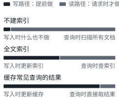
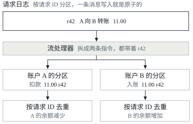

这是 DDIA 读书笔记的第十二篇，也是最后一篇。[第十一篇](/posts/ddia-11/)讲完流处理，全书只剩最后一章。前面的章节大多在描述数据系统现在的样子，这一章转向未来，讨论它们应该是什么样子。作者说明这些是个人的看法和推测，所以这一章用第一人称来写，也欢迎读者有不同的意见。这一篇按我理解的几条主线整理，不按书的小节顺序。文中的英文引文出自原书，其余是我自己的整理。

这一章开头引了托马斯·阿奎那的《神学大全》：

> If a thing be ordained to another as to its end, its last end cannot consist in the preservation of its being. Hence a captain does not intend as a last end, the preservation of the ship entrusted to him, since a ship is ordained to something else as its end, viz. to navigation.

一样东西如果是为别的目的而存在，它的最终目的就不可能是保全自己：船长的最终目的不是保住船，因为船是用来航行的。放在全书的最后，大概是在提醒：数据系统也不是为了保存数据本身，它要为人服务，这正是这一章最后一节的主题。

## 数据集成：派生数据，而不是分布式事务

这本书反复出现的一个主题是：任何问题都有好几种解法，各有利弊。每个软件，包括所谓的通用数据库，都是为特定的使用模式设计的，而复杂应用对数据的用法五花八门，所以不可避免要把好几个软件拼在一起：OLTP 数据库加全文索引，再加数据仓库、缓存、推荐系统。

同一份数据要在几个系统里各存一份时，必须非常清楚数据先写到哪里、哪些表示从哪些来源派生而来。比如数据先写进作为记录系统的数据库，再用[第十一篇](/posts/ddia-11/)的 CDC 按同样的顺序应用到搜索索引；如果这是更新索引的唯一途径，就能确信索引完全派生自数据库，和它保持一致。反过来，允许应用同时直接写两边，就会出现上一篇图 2 的竞态。关键是把所有输入汇集到一个决定写入全序的系统，其他表示都按这个顺序派生出来，这就是状态机复制；用 CDC 还是事件溯源的日志，并不重要。

这和分布式事务是两种达到同一目标的办法：

| | 分布式事务 | 派生数据 |
| --- | --- | --- |
| 怎样决定写入的顺序 | 用锁互斥（两阶段锁） | 用日志 |
| 怎样保证恰好生效一次 | 原子提交 | 确定性的重试加上幂等 |
| 读到的数据 | 通常线性一致 | 通常异步更新，没有同样的时序保证 |

作者认为 XA 的容错和性能都很差，在缺少一个被广泛支持的好的分布式事务协议时，基于日志的派生数据是集成不同数据系统最有前途的办法。但读己之写这样的保证仍然有用，只对人说“最终一致性不可避免，忍着吧”并没有建设性，这一章后面会讨论怎样在异步的派生系统之上提供更强的保证。

### 全序的局限

系统小的时候，全序的事件日志完全可行；规模变大以后就有了局限：吞吐量超过一台机器就得分区，跨数据中心通常各有一个领导者，微服务各管各的状态，离线的客户端直接改本地状态，这些情况下事件之间都没有确定的全序。决定全序等价于共识，而能突破单节点吞吐、又能跨地理区域工作的共识算法，还是一个开放的研究问题。

没有因果关系的事件，顺序无关紧要，可因果依赖有时藏得很深。书里的例子：一个人把分手的前任删出好友，再给其余好友发消息抱怨前任；好友关系和消息存在不同的地方，发通知的服务如果先处理了发消息、后处理了删好友，前任就会收到通知。书里坦承这个问题没有简单的答案。

## 批处理与流处理：随时可以重新派生

数据集成的目标，用作者的话说，是确保数据以正确的形式出现在所有正确的地方。批处理和流处理就是实现它的工具，两者的区别只在于输入是否有界，而且界限正在模糊：Spark 在批处理引擎上用微批做流处理，Flink 则在流处理引擎上做批处理。

批处理有很强的函数式色彩：确定性的纯函数，输出只依赖输入，输入不可变，输出只追加；流处理再加上可容错的状态。用“从一个东西派生另一个东西的数据管道”来思考整个组织的数据流，会清楚得多。派生系统原则上也可以同步维护，就像数据库在同一个事务里更新二级索引，但异步正是基于日志的系统稳健的原因：故障被局限在一处，而分布式事务里任何一个参与者失败都会让整个事务中止，把故障扩散出去。

### 重新处理，渐进地演化

流处理让输入的变化很快反映到派生视图里，批处理则能重新处理积累下来的全部历史数据，派生出新的视图。没有重新处理，[第四篇](/posts/ddia-04/)讲的模式演化只能做加一个可选字段这样的小改动；有了它，可以把数据集重构成完全不同的模型。

书里讲了一个铁路的故事。十九世纪英国有好几种互相竞争的轨距，1846 年定下标准轨距以后，其他轨距的线路先铺成三根铁轨的混合轨距，两种火车都能跑，等火车都换成标准轨距，再拆掉多余的那根。派生视图也能这样渐进地演化：把旧模式和新模式当作同一份数据上的两个视图并排维护，先让少数用户切到新视图，再逐步增加比例，最后丢掉旧视图。每一步都能回退，降低了不可逆的风险，才敢更快地改进系统。

### Lambda 架构

Nathan Marz 提出的 **Lambda 架构**（lambda architecture）把两者结合起来：输入以不可变事件的形式不断追加，同时跑批处理（比如 Hadoop）和流处理（比如 Storm），流处理快速给出近似的结果，批处理随后给出准确的结果。它推广了“在不可变事件上派生视图、需要时重新处理”的思想，可同一套逻辑要在两个框架里各写一遍，两条管道的输出还要合并；全量重新处理太贵，批处理常常改成增量的，又把流处理里的时间问题带了回来。更好的做法是在同一个系统里做两件事：用同一个引擎重放历史事件，支持恰好一次，按事件时间开窗口，Apache Beam 就提供了这样的 API。

## 拆解数据库

从最抽象的层面看，数据库、Hadoop 和操作系统做的是同一件事：存储数据，让你处理和查询它。可 Unix 和关系数据库的哲学截然不同：Unix 给程序员一层相当底层的硬件抽象，于是有了管道，和只是一串字节的文件；关系数据库给的是高层抽象，于是有了 SQL 和事务。作者把 NoSQL 运动解读为把 Unix 式的底层抽象用到分布式 OLTP 存储上。这一节试着调和两者。

执行 `CREATE INDEX` 时，数据库扫描表的一致性快照，取出被索引的字段排序、写出索引，再处理建索引期间积压的写入，之后每次写表都保持索引最新。这和[第五篇](/posts/ddia-05/)设置一个新的追随者、上一篇启动 CDC 惊人地相似，本质上都是重新处理已有的数据集，派生出一个新的视图。这样看，整个组织的数据流就像一个巨大的数据库：批处理、流处理和 ETL 像是触发器、存储过程和物化视图的维护程序，它们维护的派生数据系统像是不同类型的索引，只不过不再是一个集成产品里的功能，而是由不同的软件提供、跑在不同的机器上、由不同的团队管理。

作者推测有两条路能把不同的存储和处理工具组合成一个整体：

| | 联邦数据库 | 拆解数据库 |
| --- | --- | --- |
| 统一的是 | 读：给多种存储引擎提供一个统一的查询接口，比如 PostgreSQL 的外部数据包装器 | 写：用 CDC 和事件日志把存储系统可靠地接在一起，让数据变更到达所有该去的地方 |
| 思想传统 | 关系数据库：一个集成系统，高层查询语言，实现复杂 | Unix：小工具各做好一件事，用统一的底层接口组合 |

两者是一枚硬币的两面，作者认为让多个系统的写入保持同步是更难的问题，而跨异构存储系统的分布式事务是错误的方案：数据跨越不同技术的边界时，带幂等写入的异步事件日志要稳健、实际得多。日志带来的松耦合体现在两个层面：系统层面，某个消费者慢了或者挂了，日志替它缓冲消息，其他部分照常运行，修好以后它再追上来；人的层面，不同的团队可以各自开发、改进、维护自己的组件，日志这个接口既强到能承载相当强的一致性（持久、有序），又通用到几乎适用于任何数据。

拆解不会取代数据库：流处理器维护状态需要它，回应查询也需要它。运行很多块不同的基础设施本身就很复杂，为用不到的规模而构建，是一种过早优化。拆解的目标不是在某种负载上胜过单个数据库，而是组合多个数据库，在宽得多的负载范围上都有好的表现，是广度而不是深度。所以有一个技术能满足全部需要，就直接用它。

作者认为还缺了一块：拆解之后的数据库世界，还没有自己的 Unix shell。理想的情况是直接写 `mysql | elasticsearch`，就把 MySQL 里的文档索引到 Elasticsearch，并持续应用以后的变更，不用写定制的代码；物化视图也能声明式地定义、自动维护。differential dataflow 这样的研究是一个开始。

## 围绕数据流设计应用

这种用应用代码组合存储和处理系统的做法，作者在 2014 年的一个演讲里叫它“把数据库里外翻过来”（database inside-out）。电子表格就是一个榜样：单元格的公式引用了别的单元格，输入一变，结果自动重算。我们在数据系统层面想要的正是这个：一条记录变了，它的索引、依赖它的缓存和聚合都自动更新。作者说，大多数数据系统还有东西要向 1979 年的 VisiCalc 学习。

二级索引这样标准的派生函数，一句 `CREATE INDEX` 就够了；全文索引、机器学习模型、缓存的派生函数却要写定制的代码，而在数据库里运行应用代码，依赖管理、滚动升级、监控都很别扭，所以让一部分系统专门负责持久存储、另一部分专门运行无状态的应用代码是合理的。问题在于，你没法订阅一个可变变量的变化，只能定期去读，数据库也继承了这种被动。数据流的思路是让应用代码响应一处状态的变化，去触发另一处状态的变化。这要求消息的顺序稳定、处理可以容错，丢一条消息，派生数据就永远和源头对不上了；这些要求很苛刻，但比分布式事务便宜得多。

这和现在流行的微服务很像，只是通信机制截然不同：单向、异步的消息流，而不是同步的请求和响应。书里的例子是用另一种货币付款的购买，需要当前的汇率。微服务的做法是处理购买时去查汇率服务；数据流的做法是提前订阅汇率的更新，存进本地数据库，处理购买时只查本地。后者不仅更快，对另一个服务的故障也更稳健：

> The fastest and most reliable network request is no network request at all!

原来的远程调用，就变成了购买事件和汇率更新之间的流-表连接。当然，这个连接是和时间相关的：日后重新处理购买事件时，需要的是购买当时的汇率。

### 写路径与读路径

数据写进系统以后，可能经过多个批处理和流处理的阶段，最后每个派生数据集都更新了，这是**写路径**（write path）；用户请求时读取派生数据集、构造响应，这是**读路径**（read path）。写路径是提前做的，不管有没有人要看；读路径是有人请求时才做的。用函数式编程的话说，写路径像及早求值，读路径像惰性求值，派生数据集就是两者相遇的地方。



全文搜索就是一个例子（图 1）：不建索引，写路径什么也不用做，读路径要扫描所有文档；建了索引，写入时更新索引，查询时查索引；更进一步，为最常见的查询预先算好结果，读路径几乎什么也不用做，写路径则要在新文档出现时更新这些结果。缓存、索引和物化视图的作用其实很简单：它们移动读路径和写路径之间的边界，让写路径多做一些预先计算，省下读路径的工作。[第一篇](/posts/ddia-01/)的 Twitter 例子讲的正是这个，而且名人和普通用户的边界可以画在不同的地方，五百页之后，绕了一整圈。

这个边界还能一直推到用户的设备上。单页应用和手机应用能在本地保存大量状态，**离线优先**（offline-first）的应用因此重新受到关注：尽量用设备上的本地数据库工作，联网时再在后台和服务器同步。设备上的状态可以看作服务器状态的缓存，屏幕上的像素是客户端模型对象的物化视图。服务器发送事件（EventSource）和 WebSocket 让服务器能主动推送变化，写路径就延伸到了终端用户；设备离线时，就像上一篇的消费者记住偏移量那样，重连之后接着读[^local-first]。困难在于“请求加响应”这个假设深深地埋在数据库、框架和协议里，书里的建议是：设计数据系统时，除了查询当前状态，记得还有订阅变化这个选项。

作者还走得更远：读请求也可以表示成事件流，和写事件一起送进流处理器，读就成了读请求流和数据库之间的流-表连接。把读事件记下来，还能知道用户做决定之前看到了什么，比如网店显示的发货日期，很可能影响顾客买不买。

## 端到端的正确性

无状态的服务出了错，修好 bug、重启就行；有状态的系统被设计成永远记住东西，出了错，影响也可能永远存在。事务的原子性、隔离性和持久性是构建正确应用的主要工具，可这些基础比看上去要弱，Jepsen 测试也一再揭示出产品宣称的保证和实际行为之间的差距；可串行化和原子提交又通常只能在一个数据中心内工作。

### 端到端论证

即使数据库提供了可串行化的事务，应用也不一定不丢数据、不出错：应用有 bug、写错了数据，事务救不了你。再看一个更微妙的例子，书里的例 12-1：

```sql
BEGIN TRANSACTION;
UPDATE accounts SET balance = balance + 11.00 WHERE account_id = 1234;
UPDATE accounts SET balance = balance - 11.00 WHERE account_id = 4321;
COMMIT;
```

客户端发出 `COMMIT` 后网络断了、连接超时，它不知道事务到底提交了没有。重连之后再试一次，就已经超出了 TCP 重复抑制的范围，可能转了 22 元而不是 11 元。书里说，这个原子性的标准示例其实是错的，真实的银行不这样工作。两阶段提交也无济于事：用户在浏览器里提交表单，信号太弱没收到响应，点了“重新提交”，对 Web 服务器来说这是另一个请求，对数据库来说是另一个事务。

解决办法是给操作一个唯一的 ID，比如生成一个 UUID 放在表单里，从客户端一路带到数据库，再靠唯一性约束保证同一个 ID 只执行一次（书里的例 12-2）：

```sql
ALTER TABLE requests ADD UNIQUE (request_id);

BEGIN TRANSACTION;
INSERT INTO requests (request_id, from_account, to_account, amount)
  VALUES ('0286FDB8-D7E1-423F-B40B-792B3608036C', 4321, 1234, 11.00);
UPDATE accounts SET balance = balance + 11.00 WHERE account_id = 1234;
UPDATE accounts SET balance = balance - 11.00 WHERE account_id = 4321;
COMMIT;
```

`requests` 表其实也是一种事件日志，余额的更新完全可以由下游从这些请求事件里派生出来，只要每个事件恰好处理一次。

这是 Saltzer、Reed 和 Clark 1984 年提出的**端到端论证**（end-to-end argument）的一个例子：某些功能只有在通信系统的端点、在应用的参与下才能完整、正确地实现。TCP 在连接里去重，流处理器做到恰好一次，都挡不住用户超时后的重复提交；以太网和 TLS 的校验和查不出两端软件的 bug；只有端到端加密才防得住服务器被攻破。低层的特性仍然有用，只是不能单靠它们。作者希望有一种抽象，能让应用轻松地获得端到端的正确性，但担心我们还没找到。

### 用日志强制约束

唯一性约束需要共识：几个请求同时要同一个用户名，系统得决定接受哪一个。最常见的办法是让一个领导者做所有决定；要扩展，就按需要唯一的值分区。在基于日志的系统里也可以这样做：把每个用户名请求追加到按用户名哈希的分区，流处理器单线程地顺序读这个分区，用本地数据库记住哪些名字已被占用，再把成功或拒绝的消息写进输出流，客户端等着自己那条结果。这和[第九篇](/posts/ddia-09/)用全序广播实现线性一致的存储基本相同，原则就是：可能冲突的写入路由到同一个分区，顺序处理。

涉及多个分区的操作也能这样做，不需要原子提交。例 12-2 里，请求 ID、收款账户和付款账户可能在三个不同的分区：



关键在于先把请求作为一条消息持久地写进日志：单个对象的写入在几乎所有数据系统里都是原子的，请求要么在日志里、要么不在。之后的拆分是确定性的，崩溃重来只会产生同样的指令，下游用端到端的请求 ID 去重即可。要防止付款账户透支，可以在请求写进日志之前，再加一个按付款账户分区、维护余额的流处理器来验证。

### 及时性与完整性

事务通常是线性一致的，提交以后所有读者马上能看到；拆成多个异步的阶段就不是这样了。作者认为“一致性”这个词混淆了两种需求：

| | 及时性 | 完整性 |
| --- | --- | --- |
| 含义 | 用户看到的是系统的最新状态 | 没有损坏：数据不丢，也没有矛盾或虚假的数据 |
| 违反之后 | 暂时的，等一等、再读一次就好 | 永久的，必须显式地检查和修复 |
| 对应 | CAP 里的“一致性”，也就是线性一致性 | ACID 里的“一致性”，通常指某种应用相关的完整性 |

在大多数应用里，完整性远比及时性重要。信用卡账单上没有最近一天的交易，没有人会奇怪；可账单余额不等于交易之和，或者扣了你的钱却没付给商家，那就糟透了。ACID 事务同时提供两者，基于事件的数据流系统则把它们分开了：不显式地等待，就不保证及时性，可完整性正是流处理系统的核心，恰好一次的语义就是用来保持完整性的。把写操作表示成一条容易原子写入的消息，用确定性的函数派生出其他所有状态更新，让客户端生成的请求 ID 穿过所有处理层，让消息不可变、可以重新处理，这几样合起来，不用分布式事务也能保持完整性。

很多真实的应用其实可以接受更宽松的约束：两个人同时订了同一个座位，可以给其中一个道歉，请对方另选，这种纠正错误的改动叫**补偿事务**（compensating transaction）；卖出去的货比库存多，可以补货、道歉、打折，这和叉车压坏了仓库里的货没什么两样；航空公司和酒店本来就故意超卖。道歉的代价能否接受是一个商业决定，能接受的话，就可以先乐观地写入，事后再检查约束，只要在做难以挽回的事之前完成验证。这些应用需要完整性，却不需要约束执行的及时性。

于是，数据流系统可以在不需要协调的情况下，为很多应用提供数据管理，同时保证完整性。这样**避免协调**（coordination-avoiding）的系统比需要同步协调的系统性能更好、更能容错，比如可以以多领导者的方式跨数据中心运行，各自独立工作。需要的地方仍然可以引入同步的协调，比如不可挽回的操作之前，但没必要让所有操作都为一小部分需求付出协调的代价。协调能减少因不一致而要道的歉，却可能因为性能和可用性下降，增加因宕机而要道的歉，要找的是两者之间的平衡点。

## 信任，但要验证

讨论正确性时，总要假设某些事会出错、某些不会，比如进程会崩溃，但内存不会出错。现实中这更像是概率问题。作者以前收集过客户端的崩溃报告，有些只能用内存里随机的位翻转来解释：设备足够多，极不可能的事也会发生；Rowhammer 这样的内存访问模式，甚至能在没有故障的内存里翻转比特。软件更会出错，作者亲眼见过 MySQL 没能维护好唯一约束、PostgreSQL 的可串行化隔离出现写偏斜，而应用代码受到的审查远不如数据库。

所以要审计。HDFS 和 Amazon S3 不完全信任磁盘，后台进程持续读回文件、和其他副本比较；想确定数据还在，就得真的去读它，备份也要时常试着恢复。作者担心 ACID 数据库的文化让我们习惯了盲目信任技术，后来 NoSQL 让更弱的保证成了常态，审计机制却没有跟着发展起来。

基于事件的系统更容易审计：所有状态更新都由不可变的事件确定性地派生而来，可以用哈希检查事件存储有没有损坏，重新运行派生过程看结果是否一样，出了意外还能精确地重现当时的情况。端到端地检查整条派生管道，路径上的磁盘、网络和服务都包含在检查里了，持续的审计让人不怕改动。作者对区块链的拜占庭容错和工作量证明有所怀疑，但它们和证书透明度（Certificate Transparency）都依赖的 Merkle 树这类完整性检查的工具，也许有一天会更广泛地用在一般的数据系统里。

## 做正确的事

书的最后一节退后一步：每个系统都为某个目的而建，我们的每个行动都有预期和意料之外的后果。我们把数据当作抽象的东西来谈，可很多数据集是关于人的：他们的行为、兴趣、身份。作者认为，软件工程师只关注技术、不管后果是不够的，伦理责任也要我们来承担。

### 预测分析

用数据预测天气是一回事，预测一个人会不会再犯罪、会不会拖欠贷款、会不会大额理赔，是另一回事。组织天然倾向于谨慎，拿不准就说“不”，可一个被算法（准确或错误地）标为高风险的人，可能处处碰壁，被排除在工作、航空旅行、保险、租房和金融服务之外，这被称为“算法监狱”。刑事司法讲究无罪推定，自动化的系统却可以不经任何证明、几乎无从申诉地把人排除在社会之外。

算法从数据里学到的模式是不透明的，输入里有系统性的偏见，它就会学到并放大这种偏见。邮编甚至 IP 地址都可能是种族的强预测因子，说用带偏见的数据能训练出公平的算法，近乎荒谬，有人讽刺说，机器学习就像是偏见的洗钱。预测系统只会从过去外推，过去有歧视，它就把歧视固定下来；想让未来比过去更好，需要只有人才能提供的道德想象力：

> Data and models should be our tools, not our masters.

算法出了错，谁来负责？信用评分至少基于一个人自己的借贷记录，错了可以更正；机器学习的评分则看“和你相似的人过去怎样”，等于给人贴上刻板印象，被分错了桶的人几乎无从补救。推荐系统可能形成回音室；雇主用信用分筛选求职者，一次意外的财务困难就可能让人陷入找不到工作、信用更差的螺旋。很多后果可以通过系统思维预见：这个系统是在放大人与人之间已有的差距，还是在对抗不公？

### 隐私与追踪

用户主动交给系统的数据，是在为用户服务；可当服务靠广告维持、用户的行为作为副产品被追踪，广告主才是真正的客户，作者认为这种关系该叫作监控。书里做了一个思想实验，把常见说法里的“数据”换成“监控”：在我们监控驱动的组织里，我们收集实时的监控流，存进监控仓库。我们建起了世界上最庞大的监控基础设施，就连最极权的政权也只能梦想在每个房间里放一个麦克风。

说用户同意了服务条款，所以同意了数据收集，这站不住：用户并不清楚自己的数据被怎样处理；一个人的数据也常常透露了其他人的信息；服务几乎是社会参与所必需时，拒绝只是少数有特权的人才有的选项。有人说隐私已死，这是误解：隐私不是把一切都藏起来，而是能自由地决定向谁透露什么，监控把这个决定权从个人转到了公司手里。对靠定向广告盈利的服务来说，数据是核心资产；正因为有价值，公司、政府、罪犯都想要它，所以有人说数据是“有毒资产”。收集数据时，不仅要考虑今天的政治环境，还要考虑所有可能的未来政府。

书里把今天比作工业革命：它带来了经济增长和生活水平的提高，也带来了严重的污染、恶劣的工作条件和童工，过了很久，环保法规、安全规程和禁止童工的法律才建立起来。书里引了 Bruce Schneier 的话：

> Data is the pollution problem of the information age, and protecting privacy is the environmental challenge.

立法也许能帮上忙，比如 1995 年欧盟的数据保护指令要求个人数据只能为特定、明确、合法的目的收集，可这和大数据“尽量多收集、探索新洞察”的理念正好相反，书写作时，更新的法规还没有生效[^gdpr]。归根结底，作者认为科技行业对个人数据的态度需要一场文化上的转变：不再把用户看作要优化的指标，而是值得尊重、有尊严和自主权的人；让每个人保有对自己数据的控制，就像国家公园，不刻意保护，就会被毁掉。一个开始是不再永久保留数据，不需要时就尽快清除；另一个方向，是用密码学协议而不仅仅是政策来实施访问控制。

## 小结

我从这一章带走的几点：

- 组合多个系统时，与其用跨系统的分布式事务，不如指定记录系统，其他数据都通过日志异步地、确定性地派生出来，需要时还能重新派生，让应用渐进地演化；
- 拆解数据库是把索引、物化视图这些功能拆开，用事件日志在不同的系统之间组合起来，追求广度而不是深度；
- 缓存、索引和物化视图都是在移动写路径和读路径的边界，这个边界可以一直推到用户的设备上；
- 正确性要端到端地保证：请求 ID 一路传到底，可能冲突的写入在日志里顺序处理；完整性比及时性重要，很多约束可以事后检查、道歉修正；
- 不要盲目信任，要持续地审计；数据系统影响着真实的人，构建它的人有责任考虑它的后果。

书的最后一段说：软件和数据对世界的影响如此之大，我们工程师有责任朝着我们想要的世界努力，一个以人性和尊重对待人的世界。DDIA 的读书笔记就写到这里。

## 术语表

| 英文 | 中文 | 含义 |
| --- | --- | --- |
| data integration | 数据集成 | 让数据以正确的形式出现在所有正确的地方 |
| total order | 全序 | 所有事件排在同一个顺序里 |
| reprocessing | 重新处理 | 在已有的全部数据上重新运行转换，派生出新视图 |
| lambda architecture | Lambda 架构 | 批处理和流处理并行运行、再合并结果的架构 |
| unbundling databases | 拆解数据库 | 把数据库的功能拆开，用事件日志组合不同的系统 |
| federated database | 联邦数据库 | 给多种存储引擎提供统一的查询接口 |
| database inside-out | 把数据库里外翻过来 | 围绕数据流、用应用代码组合存储和处理系统 |
| write path / read path | 写路径 / 读路径 | 数据写入后提前完成的处理 / 请求时才做的处理 |
| offline-first | 离线优先 | 尽量用设备上的本地数据工作，联网时再同步 |
| end-to-end argument | 端到端论证 | 某些功能只能在通信的两端、在应用参与下才能正确实现 |
| duplicate suppression | 重复抑制 | 识别并丢弃重复的请求或消息 |
| uniqueness constraint | 唯一性约束 | 某个值只能出现一次，需要共识 |
| request ID | 请求 ID | 从客户端一路传到数据库的操作标识符 |
| timeliness / integrity | 及时性 / 完整性 | 看到最新状态 / 数据没有损坏 |
| compensating transaction | 补偿事务 | 事后纠正错误的操作，比如道歉和退款 |
| coordination-avoiding | 避免协调 | 不需要同步协调也能保持完整性 |
| auditing | 审计 | 检查数据的完整性 |
| Merkle tree | Merkle 树 | 能高效证明某条记录在数据集中的哈希树 |
| predictive analytics | 预测分析 | 用数据预测个人的行为并据此做决定 |
| surveillance | 监控 | 为别人的利益追踪记录人的行为 |

[^local-first]: 书写于 2017 年。作者后来和 Ink & Switch 的同事把这个方向发展成了“本地优先软件”（local-first software）：数据首先保存在用户自己的设备上，云端只负责同步和备份，离线时的并发修改用 CRDT 合并。这篇文章 2019 年 4 月发表在 Ink & Switch 的网站上，同年也作为论文发表在 Onward! 会议上。

[^gdpr]: 书写于 2017 年。这里说的更新的法规就是欧盟的《通用数据保护条例》（GDPR）：它在 2016 年 4 月通过，2018 年 5 月 25 日起适用，同时废止了 1995 年的那份指令。
