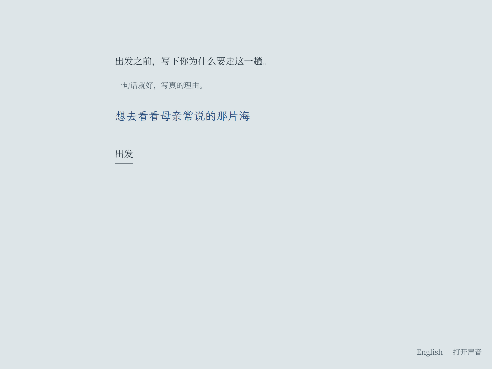
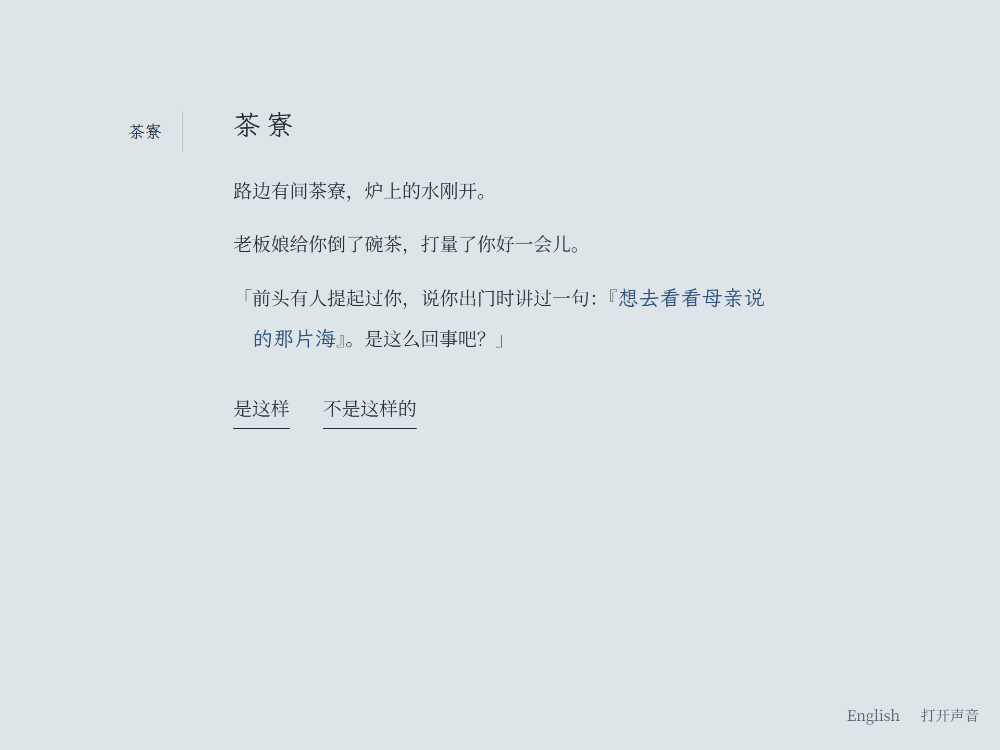
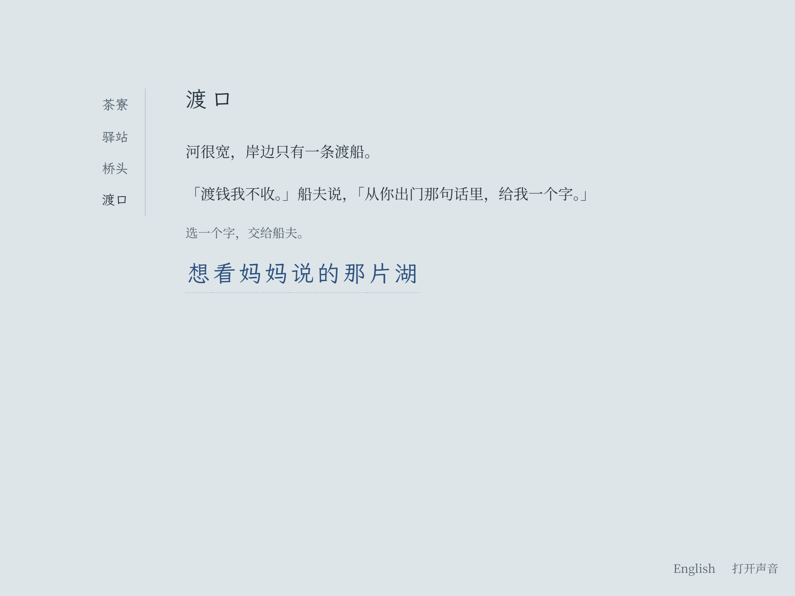
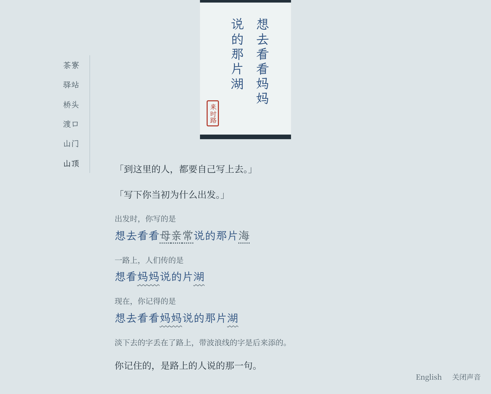
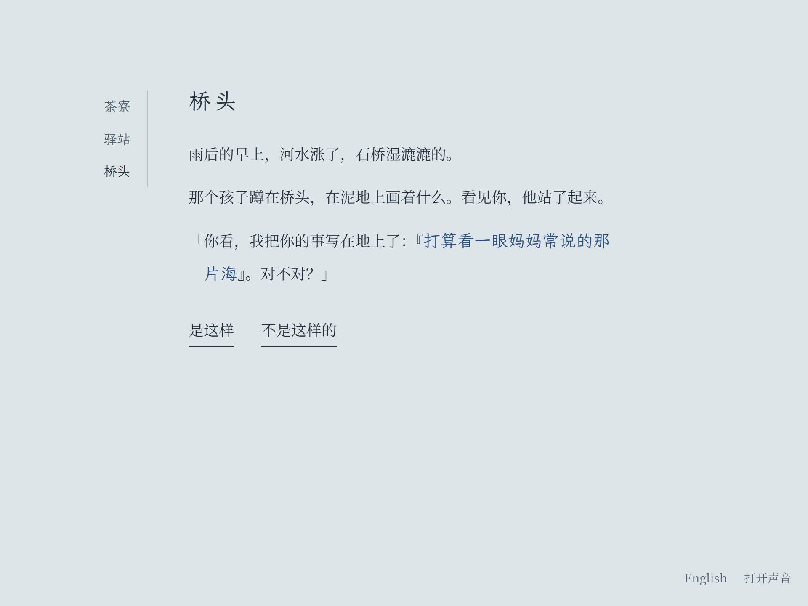
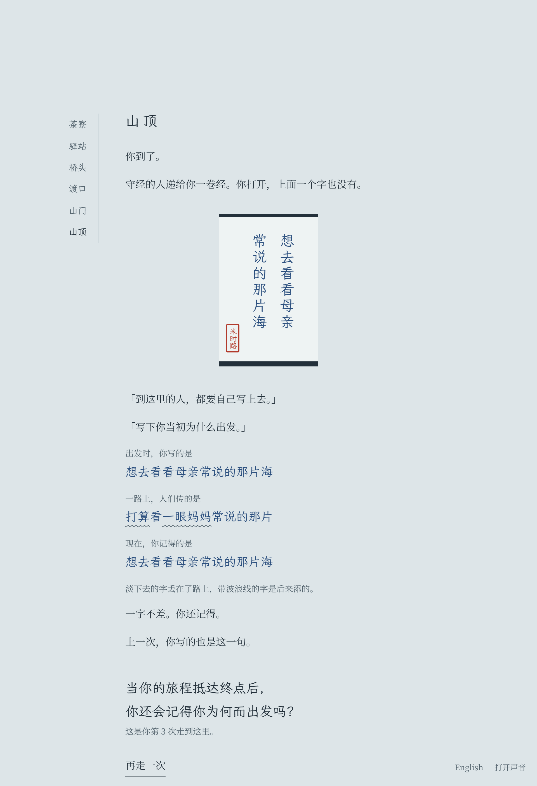

[《来时路》](https://weiguang-2099.github.io/road-we-came/)是一个五分钟左右的浏览器小游戏，有中文和英文两个版本。标题下面只有一行小字：“大约五分钟。找个安静的时候。”

成长的路上，我有时会迷茫。做这个游戏，也是想慢慢弄明白，自己往前走是为了什么。

它只问一个问题，就是走到山顶时最后出现的那一句：当你的旅程抵达终点后，你还会记得你为何而出发吗？整个游戏都在把这个问题变成一件具体的事：出发前，你写下一句理由；然后游戏把它从你手里拿走，交给路上的人去传；到了山顶，你得凭记忆把它写回来。

这一篇按旅程的顺序，讲每一段是怎么设计的。转述和对照在代码里怎么做，另写在[《让一句话在路上走样》](/posts/laishilu-drift/)里；存档、输入法、排版和发布这些工程上的事，写在[《纯静态小游戏的工程清单》](/posts/laishilu-engineering/)里。文中的截图都来自游戏本身[^1]。

## 出发：把理由交出去

点了标题页上的“开始”，接下来这一屏只有两行字和一个输入框。上面一行写着：“出发之前，写下你为什么要走这一趟。”下面一行小字：“一句话就好，写真的理由。”输入框最多写四十个字，最少两个字：渡口要收走一个字，只写一个字的话，交出去就什么也不剩了。

按下“出发”以后，你写的字会一个一个变淡、变模糊，往上飘散，然后出现一句：“这句话，路上的人会替你记着。”

从这里开始，直到山顶，游戏不会再把你写的原句给你看。你之后看到的每一个版本，除了你自己纠正时重写的那句，都是别人说出来的。

## 路上：一句话，三个人

茶寮、驿站、桥头，三个人各把这句话转述给你听一遍：

| 地点 | 谁 | 怎么说起 |
| --- | --- | --- |
| 茶寮 | 煮茶的老板娘 | 「前头有人提起过你，说你出门时讲过一句：『……』。是这么回事吧？」 |
| 驿站 | 灯下记账的掌柜 | 「你的事我听说了。出门那天，你说的是『……』，对不对？」 |
| 桥头 | 扔石子的孩子 | 「我知道你！大人都说，你出门是因为『……』！」 |

说法的来源一站比一站远：从“前头有人提起过你”，到“你的事我听说了”，再到“大人都说”。走到桥头，你的理由已经成了大人们都在说、孩子也背得出来的一件事。每到一站，这句话通常会再走样一点：茶寮改一处，驿站和桥头最多各改两处。

茶寮只改一处，所以这一站听到的，往往和原句差得不多。图 2 里，老板娘说的是“想去看看母亲说的那片海”，只少了一个“常”。不仔细对，很容易就认下了。

转述里的那句话，用的是和你写字时一样的楷体和花青色。别人的说法和你自己写下的字，在屏幕上看起来一模一样。

### 认下容易，纠正难

每一站都只有两个选择：“是这样”和“不是这样的”。

认下只要点一下。纠正就麻烦得多：对方会让你自己说一遍（“那你自己说说，是怎么讲的？”），你得把这句话重新写出来。屏幕上没有原句可以照着抄，只能凭记忆。

纠正以后，对方会照你说的往下传：“记下了。后面有人问起，我就这么说。”可纠正过的版本也会继续走样：驿站的掌柜把你的话抄进账本，“字写得很潦草”；后面再有人转述，用的就是你纠正过的那一句，照样会再被改上几处。

## 渡口：自己挑一个字

河很宽，只有一条渡船。船夫不收钱：“从你出门那句话里，给我一个字。”

他摆出来的是一路传到这里的那句话，不是你的原句。图 3 里，“母亲”已经成了“妈妈”，“海”成了“湖”，“去”“常”和一个“看”都丢在了路上。每个字都是一个按钮，点哪一个，那个字就歪着身子往右下方漂走，慢慢模糊，不见了。船夫把它收进袖子里：“这个字，河替你记着。”

路上的走样是别人造成的，这一个字是你自己挑的。给一个无关紧要的“的”，还是给那个最要紧的“湖”，由你决定。图 3 那一趟，交出去的是“那”。

## 山门：说得多了，也就当了真

过了河就是山。台阶很长，你走了很久。山门口有位扫地的老人，停下扫帚看你，说了两句话：

> 「上山的人，都说得出自己为什么来。」\
> 「说得多了，也就当了真。」

他说的，就是这一路上发生的事。这里没有选择，只有一个“继续”。再往上，你就要凭记忆把那句话写出来了。

## 山顶：一卷空白的经

山顶上，守经的人递给你一卷经，打开，一个字也没有。“到这里的人，都要自己写上去。”守经的人说，“写下你当初为什么出发。”输入框里的提示是“凭记忆写”。

写好以后，你的字会一个一个落到经卷上，竖着写，最后盖上一方朱红的印：“来时路”。页面是月白色的，凡是你写的字（还有别人转述的那句）都是花青色，这方印是整个游戏里唯一的红色。系统开着深色模式时，底色换成深灰蓝，花青的字换成浅蓝，印还是唯一的红色。经卷上留下的，是你此刻记得的那句，不是你出发时写的那句。

接着，三句话排在一起：出发时你写的，一路上人们传的，现在你记得的。没被记住的字会淡下去，后来添的字下面带波浪线。

然后是一句评语，一共六种。从上往下对，先对上哪一条，就是哪一句：

| 你写回来的 | 评语 |
| --- | --- |
| 和原句一字不差 | 一字不差。你还记得。 |
| 里面有路上添的词，而且离路上传的那句不比离原句远 | 你记住的，是路上的人说的那一句。 |
| 大半是自己的话，但混进了路上的说法 | 你记得大半。可有的字，已经换成了路上的说法。 |
| 大半是自己的话 | 你记得大半。有几个字，留在了路上。 |
| 只剩一点 | 你只记得一点。剩下的，路替你改了。 |
| 几乎什么都没剩下 | 你忘了。可你还是走到了这里。 |

山顶不给分数。分数其实算出来了，也存进了浏览器，但从来不显示，玩家看到的只有这一句话。就算全忘了，评语也不是“失败”，而是“可你还是走到了这里”。

评语之后，游戏才把那个问题摆出来，用比正文大一号的楷体：“当你的旅程抵达终点后，你还会记得你为何而出发吗？”下面一个按钮：“再走一次”。

## 再走一次

走过的每一趟都存在浏览器里。再走一次，路上的人会认出你：

- 第二趟，茶寮还在老地方，老板娘看见你，愣了一下：“又是你。”驿站的掌柜认出了你，搁下笔，往灯里添了点油。桥头那个孩子好像长高了一点，老远就喊：“你又来啦！”
- 第三趟，下起了小雨，你在茶寮檐下站了一会儿。雨一直下到驿站，堂屋里挤满了躲雨的客人。第二天早上，雨停了，河水涨了，那个孩子蹲在桥头，把你的事写在了泥地上。

点“是这样”，孩子会在那行字底下再画一条船；点“不是这样的”，他用脚抹掉那行字，照你说的，一笔一画重写一遍。

三个地方的台词是按“趟”写的：同一趟路上，三站用的是同一套，所以雨能从茶寮一直下到驿站，到了桥头才是雨后。从第四趟起，第二趟和第三趟的两套台词轮流出现。

山顶也记得你。从第二趟起，评语后面会多一句，告诉你上一次出发时写的是什么；两次写的是同一句，就说“上一次，你写的也是这一句。”那个问题下面还会多一行小字，记着你是第几次走到这里，比如图 6 这一趟：“这是你第 3 次走到这里。”

上过一次路以后，标题页上会多出一个不太显眼的选项：“抹去走过的路”。它会先提醒你：“写下的字都会抹去，不会再回来。”确认以后，走过的每一趟、写过的每一句都会清空，声音和语言的设置不受影响。再上路时，路上的人又不认识你了，一切从第一趟重新开始。

## 其他细节

- 每一行字出现以后，要隔一会儿才出下一行，好让你读完：450 毫秒，再加上每个字 55 毫秒，最长 2.4 秒。点一下、按回车或空格，可以提前往下走。
- 选项不会自动获得焦点，所以一路按回车跳过台词时，不会误点“是这样”。
- 叙述和对白用宋体；你写的字，以及对白里转述的那句话，用霞鹜文楷。
- 风声是浏览器现场合成的：一段低沉的噪声，加一个很慢的起伏当作阵风，底下垫着两个低音。第一次点击以后才响，角落里可以关掉。
- 每做完一个决定都会存档，关掉页面，下次打开可以“继续上路”。写下的字不会离开浏览器。

## 英文版

英文版叫 *The Road We Came*，是按英文的习惯重写的，不是逐字翻译。路上的人转述时会换词、丢词、把一个词听成发音相同或相近的另一个，也会把一个词里相邻的两个字母弄颠倒（mother 成了 motehr）。船夫收一个词，经卷改成横排，印章仍然是中文的“来时路”。输入框最多写 90 个字符。最后那个问题在英文里是：At the end of the road, will you still know why you began?

## 小结

这个游戏没有输赢，也不告诉你答案。它只做一件事：让你写下一句话，再让你在五分钟以后，凭记忆把它找回来。找回来多少，评语会说；记住的是谁的话，三行对照会说。那个问题，要你自己回答。想试试的话，可以去[走一趟](https://weiguang-2099.github.io/road-we-came/)。

[^1]: 截图是在本地运行游戏、用准备好的存档直接跳到对应的一站截的，窗口 960 × 720；图 4 的窗口拉高到 960 × 770，图 6 是整页截图。路上的转述都是游戏按存档里的种子算出来的。
